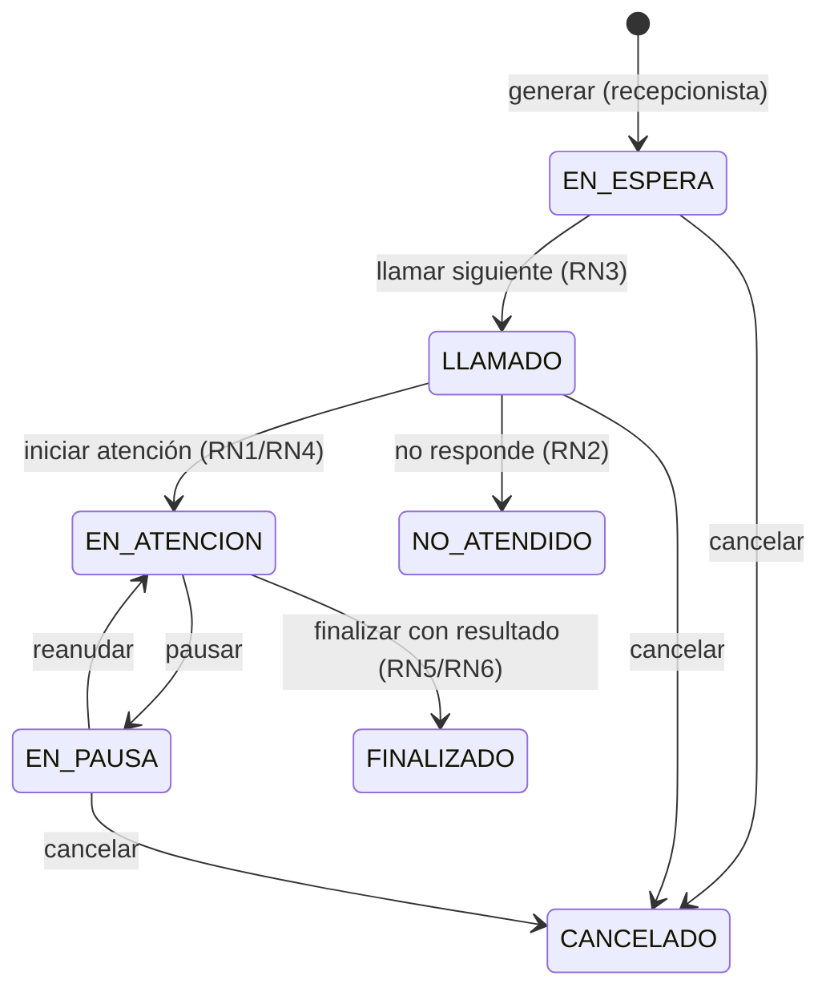

# Agendaty

Agendaty es una plataforma de gestión de turnos y atención al ciudadano. Separa un backend Spring Boot 4.1.1 (Java 25) de un frontend React 18 + TypeScript + Vite. El sistema registra solicitudes, asigna turnos, administra ventanillas y asesores, controla siete estados de atención y genera reportes de tiempos de espera. El proyecto nace como ejercicio académico y demostración didáctica: prioriza la claridad del código y del contrato REST sobre infraestructura compleja.

Este README es la única fuente de documentación del repositorio. Reúne la especificación funcional, la arquitectura, el modelo de datos, la referencia de la interfaz de programación de aplicaciones (API), la configuración, las pruebas y las decisiones técnicas.

## Índice

- [Visión general](#visión-general)
- [Características](#características)
- [Roles y permisos](#roles-y-permisos)
- [Arquitectura](#arquitectura)
- [Modelo de dominio](#modelo-de-dominio)
- [Reglas de negocio y requisitos](#reglas-de-negocio-y-requisitos)
- [Stack tecnológico](#stack-tecnológico)
- [Requisitos previos](#requisitos-previos)
- [Instalación y ejecución](#instalación-y-ejecución)
- [Recorridos por rol](#recorridos-por-rol)
- [API REST](#api-rest)
- [Seguridad](#seguridad)
- [Pruebas y calidad](#pruebas-y-calidad)
- [Decisiones técnicas](#decisiones-técnicas)
- [Limitaciones conocidas](#limitaciones-conocidas)
- [Estructura del repositorio](#estructura-del-repositorio)
- [Licencia](#licencia)

## Visión general

Una entidad pública, institución educativa o centro de servicios atiende usuarios por orden de llegada o con listas manuales. Ese enfoque genera congestión, pérdida de turnos, esperas largas, poca trazabilidad y dificultad para medir la calidad del servicio.

Agendaty resuelve ese problema con un flujo digital: el ciudadano se registra, la recepción genera un turno, el asesor lo atiende y el coordinador consulta los reportes. Cada cambio de estado queda registrado y los tiempos de espera y atención se calculan de forma automática.

### Usuarios

- **Ciudadano**: se registra y consulta el estado de su turno.
- **Recepcionista**: genera turnos, administra la cola y cancela turnos.
- **Asesor**: llama al siguiente turno y gestiona la atención.
- **Coordinador**: supervisa la cola, la carga por asesor y los reportes.
- **Administrador**: crea usuarios, ventanillas y tipos de trámite.

### Módulos

| Módulo | Funcionalidades |
|--------|-----------------|
| Solicitudes | Registro del trámite o motivo de atención |
| Turnos | Generación, llamado, cancelación y consulta |
| Atención | Inicio, pausa, reanudación, finalización y observaciones |
| Asesores | Disponibilidad, ventanilla asignada y carga de atención |
| Estados | En espera, llamado, en atención, en pausa, finalizado, cancelado y no atendido |
| Reportes | Espera promedio, turnos atendidos y trámites frecuentes |

## Características

- Registro público con rol de ciudadano forzado en el backend.
- Inicio de sesión con correo y contraseña, y sesión persistida en el navegador.
- Administrador sembrado al arrancar, con tipos de trámite iniciales.
- Alta de usuarios internos y ciudadanos desde el panel de administración.
- Turnos normales y prioritarios con numeración única diaria.
- Atención con pausa, reanudación y resultado obligatorio al finalizar.
- Cálculo y persistencia de tiempos de espera y atención.
- Paneles por rol con indicadores derivados de los datos existentes.
- Reportes filtrables por rango de fechas, asesor y tipo de trámite.
- Interfaz accesible: etiquetas asociadas, navegación por teclado, regiones vivas y respeto a `prefers-reduced-motion`.

## Roles y permisos

La matriz siguiente describe el contrato de la aplicación. El frontend restringe las pantallas por rol y el backend valida el rol en los servicios que implementan esa comprobación.

| Acción | Ciudadano | Asesor | Recepcionista | Coordinador | Administrador |
|--------|-----------|--------|---------------|-------------|---------------|
| Registrarse y acceder | Sí | Sí | Sí | Sí | Sí |
| Generar turno | No | No | Sí | No | Sí |
| Llamar siguiente turno | No | Sí | No | No | No |
| Iniciar, pausar, reanudar y finalizar atención | No | Sí | No | No | No |
| Cancelar turno y marcar no atendido | No | No | Sí | No | Sí |
| Cambiar disponibilidad de asesor | No | No | No | No | Sí |
| Ver reportes | No | No | No | Sí | Sí |
| Crear usuarios internos y ciudadanos | No | No | No | No | Sí |
| Gestionar ventanillas y tipos de trámite | No | No | No | No | Sí |
| Consultar el estado de su turno | Sí | No | No | No | No |

## Arquitectura

El backend expone una API REST y el frontend la consume mediante peticiones HTTP. No hay capa de presentación en el servidor ni monorepo con dependencias compartidas; cada proyecto tiene su propio proceso de construcción.

```mermaid
graph TD
    subgraph Frontend "Frontend (React + Vite, puerto 5173)"
        F1[Pages por rol]
        F2[AuthContext + localStorage]
        F3[Cliente HTTP]
    end

    subgraph Backend "Backend (Spring Boot, puerto 8080)"
        B1[Controllers con @CrossOrigin]
        B2[Services transaccionales]
        B3[Repositories JPA]
        B4[Entities JPA]
    end

    subgraph DB "H2 en memoria, desarrollo"
        D1[(Usuarios, turnos, atenciones y catálogos)]
    end

    F1 --> F3
    F2 --> F3
    F3 -->|HTTP + X-Usuario-Id| B1
    B1 --> B2
    B2 --> B3
    B3 --> B4
    B4 --> D1
```

### Capas del backend

El backend sigue el flujo `controller → service → repository → entity`. El paquete base es `com.proyecto.agendaty` y se organiza en `controller`, `service`, `repository`, `entity`, `dto`, `mapper`, `exceptions`, `config`, `security` y `model.enums`. La inyección de dependencias se hace por constructor.

### Flujo de una petición

1. El controller recibe la petición HTTP, valida el cuerpo con `@Valid` y llama al servicio.
2. El servicio aplica las reglas de negocio RN1 a RN6 y la validación de rol dentro de una transacción.
3. El repositorio lee o escribe en la base de datos a través de JPA.
4. El controller devuelve un DTO con el código HTTP correspondiente.

### Manejo de errores y concurrencia

Un `@RestControllerAdvice` centraliza las excepciones propias y las traduce a respuestas con `timeStamp`, `status`, `errorMessage` y `errorsDetails`. Las reglas RN1 y RN4 se validan dentro de `@Transactional`; el diseño prevé `@Version` en `Turno` si hace falta protección adicional bajo concurrencia.

El CORS se declara con `@CrossOrigin(origins = "http://localhost:5173")` en cada controller. El puerto 5173 es el origen permitido por defecto y no se usa el comodín `*`.

## Modelo de dominio

Las entidades se organizan alrededor del turno. `Usuario` es la entidad padre de `Asesor` y `Ciudadano` mediante herencia `JOINED`.

| Entidad | Atributos principales | Relaciones |
|---------|----------------------|------------|
| `Usuario` | id, nombre, correo, contraseña, rol | Padre de asesor y ciudadano |
| `Asesor` | disponible, ventanilla actual | 1:1 con ventanilla, N:1 con atenciones |
| `Ciudadano` | documento, teléfono | N:1 con turnos solicitados |
| `Ventanilla` | número, descripción | 1:1 con el asesor actual |
| `TipoTramite` | nombre, código, prioritario por defecto, activo | N:1 con turnos |
| `Turno` | número, estado, prioridad, fechas, ciudadano, trámite, asesor | N:1 con ciudadano, trámite y asesor; 1:1 con atención |
| `Atencion` | turno, asesor, fechas, observaciones, resultado, tiempos | 1:1 con turno, N:1 con asesor |

### Estados del turno



### Numeración y tiempos

El número de turno sigue el formato `{CODIGO_TRAMITE}{P|N}-{NNNNN}`. El código identifica el trámite, `P` o `N` indican prioridad y el consecutivo de cinco dígitos se reinicia cada día. La columna `numeroTurno` tiene una restricción única.

El tiempo de espera es `fechaLlamado - fechaCreacion`. El tiempo de atención es `fechaFin - fechaInicio` descontando las pausas. Ambos se guardan en `Atencion` al finalizar.

## Reglas de negocio y requisitos

| Regla | Descripción |
|-------|-------------|
| RN1 | Un turno no puede ser atendido por dos asesores a la vez |
| RN2 | Un turno llamado sin respuesta pasa a `NO_ATENDIDO` |
| RN3 | Los turnos prioritarios se atienden antes que los normales |
| RN4 | Un asesor solo puede tener un turno activo |
| RN5 | Toda atención finalizada requiere un resultado |
| RN6 | El sistema calcula y persiste espera y atención |

Los criterios de aceptación de la generación de turnos son CA1 (seleccionar trámite), CA2 (número único), CA3 (estado inicial `EN_ESPERA`), CA4 (diferenciar prioridad) y CA5 (llamado del siguiente turno disponible).

Los requisitos adicionales son RA1 (registro público con rol forzado), RA2 (login con correo y contraseña), RA3 (administrador semilla), RA4 (gestión de usuarios por el administrador), RA5 (contraseñas con BCrypt), RA6 (autorización por `X-Usuario-Id`) y RA7 (matriz de permisos por rol).

## Stack tecnológico

### Backend

| Tecnología | Versión | Uso |
|------------|---------|-----|
| Java | 25 | Lenguaje y entorno de ejecución |
| Spring Boot | 4.1.1 | Web, JPA, validación y pruebas |
| Maven | Wrapper incluido | Construcción y dependencias |
| H2 | Gestionada por Spring Boot | Base de datos en memoria |
| Lombok | Gestionado por Spring Boot | Reducción de código repetitivo |
| spring-security-crypto | Gestionado por Spring Boot | Hash BCrypt de contraseñas |
| JUnit 5 y Mockito | Incluidos en `spring-boot-starter-test` | Pruebas unitarias |
| JaCoCo, PIT y SonarQube | 0.8.14, 1.30.0, 4.0.0.4121 | Cobertura, mutaciones y análisis estático |
| springdoc-openapi | 3.2.0 | Documentación OpenAPI y Swagger UI |

### Frontend

| Tecnología | Versión | Uso |
|------------|---------|-----|
| React | 18.3.1 | Interfaz de usuario |
| TypeScript | 5.6.3 | Tipado estático |
| Vite | 5.4.10 | Servidor de desarrollo y build |
| React Router DOM | 6.28.0 | Rutas y protección por rol |
| Axios | 1.7.7 | Cliente HTTP |
| Tailwind CSS | 3.4.14 | Sistema de diseño |
| Lucide React | 0.453.0 | Iconos |
| Sonner | 2.0.8 | Notificaciones |
| Vitest y Testing Library | 2.1.3, 16.3.3 | Pruebas de componentes |
| ESLint | 10.15.0 | Análisis estático |

## Requisitos previos

- Java 25 o superior para el backend.
- Maven mediante el wrapper incluido en `backend/mvnw`.
- Node.js 18 o superior y npm para el frontend.
- Un navegador web moderno.

No necesitas instalar una base de datos: el perfil de desarrollo usa H2 en memoria.

## Instalación y ejecución

### Backend

```powershell
cd backend
./mvnw spring-boot:run
```

La API queda disponible en `http://localhost:8080`. La documentación interactiva se sirve en `http://localhost:8080/swagger-ui.html` y la especificación OpenAPI en `http://localhost:8080/v3/api-docs`. La consola H2 está en `http://localhost:8080/h2-console` con JDBC `jdbc:h2:mem:agendaty`, usuario `sa` y contraseña vacía. Los datos se pierden al reiniciar el proceso.

El administrador semilla lee `ADMIN_EMAIL` y `ADMIN_PASSWORD` del entorno del proceso. Si no las defines, se usan los valores de desarrollo.

| Variable | Descripción | Valor por defecto |
|----------|-------------|-------------------|
| `ADMIN_EMAIL` | Correo del administrador creado al arrancar | `admin@turnos.local` |
| `ADMIN_PASSWORD` | Contraseña del administrador creado al arrancar | `Admin123*` |
| `SONAR_TOKEN` | Token para el análisis de SonarQube | Sin valor |

En PowerShell puedes definir las variables antes de arrancar:

```powershell
$env:ADMIN_EMAIL = "admin@turnos.local"
$env:ADMIN_PASSWORD = "Admin123*"
./mvnw spring-boot:run
```

### Frontend

```powershell
cd frontend
cp .env.example .env
npm install
npm run dev
```

La aplicación queda disponible en `http://localhost:5173`.

| Variable | Descripción | Valor por defecto |
|----------|-------------|-------------------|
| `VITE_API_URL` | URL base del backend | `http://localhost:8080` |
| `VITE_USE_MOCK` | Simula login y registro sin backend | `true` |
| `VITE_POLL_INTERVAL_MS` | Intervalo de actualización del monitor | `5000` |
| `VITE_APP_TITLE` | Título de la aplicación | `Agendaty - Atención al Ciudadano` |

Para trabajar contra el backend real, pon `VITE_USE_MOCK=false` en `frontend/.env` y mantén el backend en ejecución. Con `VITE_USE_MOCK=true` solo se simulan login y registro; las demás pantallas necesitan el backend.

### Credenciales de desarrollo

El backend crea un administrador al arrancar si no existe ninguno con ese correo. También siembra los tipos de trámite Cédula de Identidad (`CED`), Pasaporte (`PAS`) y Licencia de Conducir (`LIC`) cuando la tabla está vacía.

| Correo | Contraseña | Rol | Origen |
|--------|------------|-----|--------|
| `admin@turnos.local` | `Admin123*` | `ROLE_ADMINISTRADOR` | Seed del backend |
| `admin@turnos.local` | `Admin123*` | `ROLE_ADMINISTRADOR` | Usuario de ejemplo en modo mock |
| `recepcion@turnos.local` | `Rec123*` | `ROLE_RECEPCIONISTA` | Usuario de ejemplo en modo mock |
| `asesor@turnos.local` | `Ase123*` | `ROLE_ASESOR` | Usuario de ejemplo en modo mock |
| `coord@turnos.local` | `Cor123*` | `ROLE_COORDINADOR` | Usuario de ejemplo en modo mock |
| `juan@email.com` | `Cli123*` | `ROLE_CIUDADANO` | Usuario de ejemplo en modo mock |

Cambia estas credenciales antes de exponer el sistema fuera del entorno de desarrollo.

### Docker

El repositorio incluye `docker-compose.yml` y un `Dockerfile` por módulo. Compose levanta el backend con H2 en memoria y el frontend con nginx, sin servicios de base de datos externos. Las rutas, el prefijo de la API y las credenciales coinciden con la ejecución local.

```powershell
docker compose up --build
```

El frontend usa `VITE_API_URL` y `VITE_USE_MOCK=false` como argumentos de construcción, porque Vite los incorpora al bundle durante el `build`. Puedes cambiarlos con variables de entorno antes de ejecutar Compose. La API queda en `http://localhost:8080` y la aplicación en `http://localhost:5173`. Los datos de H2 se pierden al recrear el contenedor del backend.

## Recorridos por rol

| Rol | Ruta principal | Flujo |
|-----|----------------|-------|
| Ciudadano | `/ciudadano` | Registrarse, acceder y consultar el estado del turno |
| Recepcionista | `/recepcionista` | Elegir trámite, generar turno, ver la cola y cancelar si hace falta |
| Asesor | `/asesor` | Llamar siguiente, iniciar, pausar, reanudar y finalizar con resultado |
| Coordinador | `/coordinador` | Ver la cola en vivo, la carga por asesor y los reportes |
| Administrador | `/administrador` | Crear usuarios, gestionar ventanillas y tipos de trámite |
| Reportes | `/reportes` | Filtrar por fecha y consultar espera, atendidos y trámites frecuentes |

El destino de cada rol se calcula en una sola función, `getHomeByRole`, que reutilizan la navegación, la landing, el login y las rutas protegidas. Con sesión activa, las pantallas públicas muestran «Ir a mi panel» en lugar de «Iniciar sesión» y «Crear cuenta».

## API REST

La base es `http://localhost:8080` y las rutas son cortas, sin prefijo de versión. Las peticiones protegidas envían el header `X-Usuario-Id` con el identificador del usuario. El cuerpo de error sigue el formato `ErrorResponse(timeStamp, status, errorMessage, errorsDetails)`.

### Autenticación y administración

| Método | Ruta | Rol | Descripción |
|--------|------|-----|-------------|
| POST | `/auth/registro` | Público | Registra un ciudadano y devuelve sus datos |
| POST | `/auth/login` | Público | Valida credenciales y devuelve los datos del usuario |
| POST | `/admin/usuarios` | Administrador | Crea un usuario interno o ciudadano |
| GET | `/admin/usuarios` | Administrador | Lista los usuarios |

### Turnos y atención

| Método | Ruta | Rol | Descripción |
|--------|------|-----|-------------|
| POST | `/turnos?usuarioId=X` | Recepción, administrador | Genera un turno |
| GET | `/turnos` | Autenticados | Lista turnos con filtros opcionales |
| GET | `/turnos/{id}` | Autenticados | Consulta un turno |
| PUT | `/turnos/llamar-siguiente?asesorId=X` | Asesor | Llama al siguiente turno según prioridad |
| PUT | `/turnos/{id}/cancelar?usuarioId=X` | Recepción, administrador | Cancela un turno |
| PUT | `/turnos/{id}/no-atendido` | Recepción, administrador | Marca un turno como no atendido |
| PUT | `/atenciones/iniciar?turnoId=X&asesorId=Y` | Asesor | Inicia una atención |
| PUT | `/atenciones/{turnoId}/pausar?asesorId=Y` | Asesor | Pausa una atención |
| PUT | `/atenciones/{turnoId}/reanudar?asesorId=Y` | Asesor | Reanuda una atención |
| PUT | `/atenciones/{turnoId}/finalizar?asesorId=Y` | Asesor | Finaliza con resultado y observaciones |
| GET | `/atenciones/turno/{turnoId}` | Autenticados | Consulta la atención de un turno |

### Catálogos y reportes

| Método | Ruta | Rol | Descripción |
|--------|------|-----|-------------|
| GET | `/asesores` | Autenticados | Lista asesores y su disponibilidad |
| GET | `/asesores/{id}` | Autenticados | Consulta un asesor |
| PUT | `/asesores/{id}/disponible?disponible=true` | Administrador | Cambia la disponibilidad |
| GET | `/ventanillas` | Autenticados | Lista ventanillas |
| POST | `/ventanillas` | Administrador | Crea una ventanilla |
| PUT | `/ventanillas/{id}` | Administrador | Edita una ventanilla |
| DELETE | `/ventanillas/{id}` | Administrador | Elimina una ventanilla |
| GET | `/tipos-tramite` | Autenticados | Lista tipos de trámite |
| POST | `/tipos-tramite` | Administrador | Crea un tipo de trámite |
| PUT | `/tipos-tramite/{id}` | Administrador | Edita un tipo de trámite |
| DELETE | `/tipos-tramite/{id}` | Administrador | Elimina un tipo de trámite |
| GET | `/ciudadanos` | Autenticados | Lista ciudadanos |
| POST | `/ciudadanos` | Autenticados | Crea un ciudadano |
| GET | `/ciudadanos/{id}` | Autenticados | Consulta un ciudadano |
| PUT | `/ciudadanos/{id}` | Autenticados | Edita un ciudadano |
| POST | `/usuarios/asesores/{numeroVentanilla}` | Autenticados | Crea un asesor en una ventanilla |

Los tres endpoints de reportes aceptan `fechaDesde` y `fechaHasta` como fecha y hora ISO 8601, por ejemplo `2026-11-09T00:00:00`. El frontend envía el inicio con `T00:00:00` y el fin con `T23:59:59.999`.

| Método | Ruta | Filtros adicionales | Respuesta |
|--------|------|---------------------|-----------|
| GET | `/reportes/tiempo-espera-promedio` | `asesorId`, `tipoTramiteId` | `metrica`, `valor`, `cantidad_atenciones`, `fecha_desde`, `fecha_hasta` |
| GET | `/reportes/turnos-atendidos` | `asesorId`, `tipoTramiteId` | `metrica`, `atendidos`, `no_atendidos`, `total`, `fecha_desde`, `fecha_hasta` |
| GET | `/reportes/tramites-frecuentes` | `tipoTramiteId` | Lista con `tipo_tramite_id`, `tipo_tramite_nombre` y `cantidad` |

### Códigos HTTP

| Código | Significado |
|--------|-------------|
| 200 | Petición correcta |
| 201 | Recurso creado |
| 204 | Recurso eliminado, sin contenido |
| 400 | Validación o regla de negocio incumplida |
| 401 | Credenciales inválidas |
| 403 | Rol insuficiente |
| 404 | Recurso no encontrado |
| 409 | Conflicto, por ejemplo turno ya tomado o asesor con turno activo |

## Seguridad

El registro público fuerza el rol `ROLE_CIUDADANO` y descarta cualquier rol enviado en la petición. El login comprueba la contraseña con BCrypt mediante `spring-security-crypto`, sin activar Spring Security completo. Las contraseñas nunca se devuelven en las respuestas.

Las peticiones protegidas envían `X-Usuario-Id`; el servicio busca al usuario y comprueba su rol. Este esquema es didáctico y sirve para enseñar autorización por rol, no para proteger un despliegue real. En producción se necesitaría autenticación con tokens y comprobaciones en todos los endpoints.

La validación de entrada usa Bean Validation en los DTO y comprobaciones de regla de negocio en los servicios. Los controllers fijan el origen CORS en `http://localhost:5173` y no registran contraseñas ni datos sensibles en los logs.

## Pruebas y calidad

```powershell
cd backend
./mvnw test           # 165 pruebas JUnit 5 y Mockito
./mvnw verify         # Pruebas más comprobación de cobertura JaCoCo

cd ../frontend
npm run test          # 31 pruebas con Vitest y Testing Library
npm run lint          # ESLint, cero advertencias
npm run build         # Genera dist/
```

La ejecución actual de backend registra 165 pruebas, cero fallos y 88,7 % de cobertura de líneas con JaCoCo. El plugin `jacoco:check` exige al menos 80 % de líneas durante `verify`. PIT está configurado con umbral de cobertura 80 y umbral de mutación 50 sobre los servicios; se ejecuta con `./mvnw pitest:mutationCoverage`. SonarQube se configura con `./mvnw sonar:sonar` y consume los informes de JaCoCo y PIT.

Las pruebas del backend siguen Arrange-Act-Assert, usan nombres descriptivos en español y un reloj inyectable para los cálculos de tiempo. La trazabilidad de requisitos queda resumida así:

| Requisito | Prueba representativa |
|-----------|----------------------|
| CA1 a CA4 | `TurnoServiceImpTest` sobre generación de turnos |
| CA5 y RN3 | `TurnoServiceImpTest` sobre llamada del siguiente turno |
| RN1 y RN4 | `AtencionServiceImpTest` sobre turno ya atendido y asesor ocupado |
| RN2 | `TurnoServiceImpTest` sobre turno llamado sin respuesta |
| RN5 y RN6 | `AtencionServiceImpTest` sobre resultado y cálculo de tiempos |
| RA1, RA2, RA4 a RA6 | `AuthServiceTest` sobre rol forzado, login, alta de usuarios y BCrypt |

El frontend cubre el badge de estado, las rutas protegidas, login, registro, generación de turno, navegación pública sensible a la sesión y tolerancia a datos de sesión corruptos.

## Decisiones técnicas

Estas decisiones explican por qué el proyecto tiene la forma que tiene. Se numeran como ADR, registros de decisión de arquitectura.

### Fundamentos

- **ADR-001**: simplicidad sobre sofisticación; se descartan JWT, Spring Security completo y mappers complejos.
- **ADR-002**: siete estados de turno, incluido `EN_PAUSA`.
- **ADR-003**: numeración con consecutivo diario y restricción única.
- **ADR-004**: autenticación didáctica con BCrypt y `X-Usuario-Id`.
- **ADR-005**: rutas cortas, sin `/api/v1`.
- **ADR-006**: registro público siempre como ciudadano.
- **ADR-007**: administrador semilla mediante `CommandLineRunner`.
- **ADR-008**: solo el administrador crea usuarios internos y ciudadanos.
- **ADR-009**: RN2 se resuelve con un endpoint explícito, sin tareas programadas.
- **ADR-010**: RN1 y RN4 se validan en transacciones, con `@Version` como refuerzo opcional.

### Frontend

- **ADR-011**: biblioteca de componentes propia sobre Tailwind, sin shadcn ni Radix.
- **ADR-012**: tokens de diseño centralizados en `tailwind.config.js`.
- **ADR-013**: modo oscuro fuera de alcance, con tokens preparados para añadirlo.
- **ADR-014**: badges con punto y etiqueta en español, no solo color.
- **ADR-017**: dirección institucional clara, densa y directa, con accesibilidad como prioridad.
- **ADR-018**: cuatro KPIs del administrador derivados de `GET /admin/usuarios`.
- **ADR-020**: acciones de fila solo cuando el contrato REST las soporta.
- **ADR-021**: navegación pública sensible a la sesión, con `getHomeByRole` como fuente única.

### Contrato y operación

- **ADR-015**: el contrato de reportes se documenta con los campos reales del backend.
- **ADR-016**: el panel de usuarios omite editar, desactivar y restablecer contraseña porque esos verbos no existen.
- **ADR-019**: si `GET /asesores` falla, el monitor oculta la carga por asesor y sigue funcionando.

## Limitaciones conocidas

- La base de datos H2 es en memoria: los datos desaparecen al reiniciar el backend.
- `X-Usuario-Id` no es un mecanismo de autenticación seguro; el esquema está pensado para aprendizaje.
- No existen `PATCH` ni `DELETE /admin/usuarios`, ni cambio de contraseña ni activación de usuarios.
- RN2 requiere que la recepcionista o el administrador llame al endpoint explícito.
- `GET /asesores` puede fallar cuando un asesor no tiene ventanilla asignada; el frontend degrada esa sección.
- `VITE_USE_MOCK=true` cubre solo login y registro; el resto de pantallas dependen del backend.
- El despliegue con Compose usa H2 en memoria, así que los datos no persisten al recrear el contenedor.
- La documentación OpenAPI está habilitada por defecto; en un despliegue real conviene desactivarla con `springdoc.api-docs.enabled=false` y `springdoc.swagger-ui.enabled=false`.
- La interfaz no incluye modo oscuro.
- `backend/README.md` y `frontend/README.md` son guías de módulo y conservan referencias de versiones anteriores. Este README es la fuente vigente.

## Estructura del repositorio

```text
Agendaty/
├── backend/          API REST Spring Boot, wrapper Maven, configuración y pruebas
├── frontend/         Cliente React + TypeScript + Vite
├── docker-compose.yml  Backend con H2 y frontend con nginx
├── CHANGELOG.md      Historial de versiones
└── README.md         Esta documentación
```

Dentro de `frontend/src` se organizan `api`, `components`, `hooks`, `pages`, `routes`, `context`, `types`, `test` y `utils`. Dentro de `backend/src/main/java/com/proyecto/agendaty` se organizan los paquetes listados en [Arquitectura](#arquitectura).

## Licencia

Uso interno e institucional. No se publica bajo una licencia de código abierto.
