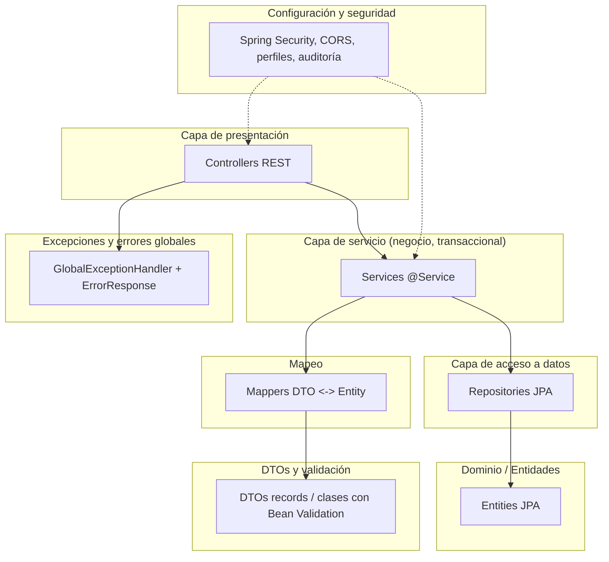
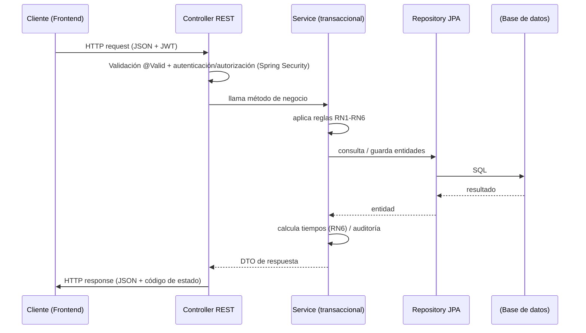
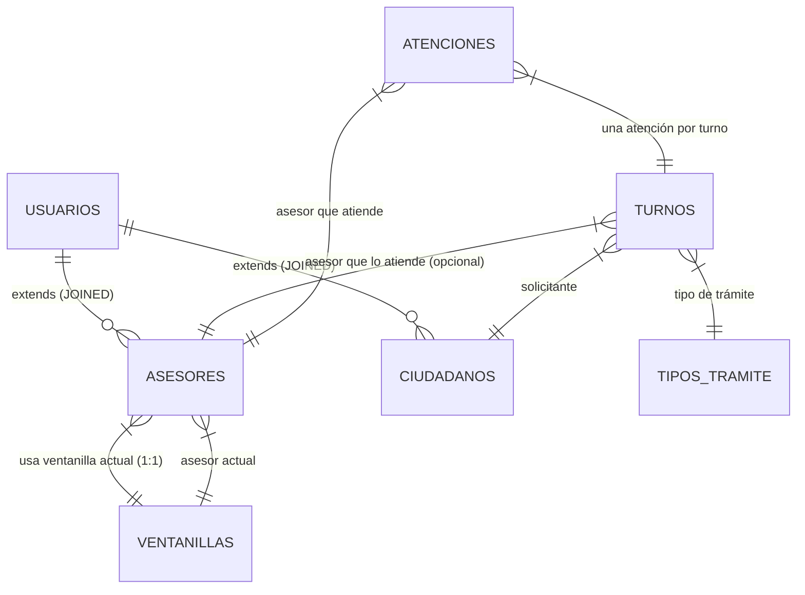

# Arquitectura — Agendaty

> Este documento se redacta ANTES de terminar el backend y se mantiene sincronizado con el código. Es el contrato de arquitectura que guía la implementación.

---

## 1. Visión general y estilo arquitectónico

**Backend y frontend separados (no monolítico).** La plataforma se construye como dos aplicaciones independientes que se comunican mediante una API REST:

- **Backend:** Spring Boot 4.1.1 (Java 25) que expone una API REST bajo `/api/v1`. Acceso a datos con Spring Data JPA sobre H2 (dev/tests) y configurable a PostgreSQL/MySQL en producción.
- **Frontend:** aplicación independiente (React + TypeScript + Vite, Fase 7) que consume la API REST.
- **Documentación:** carpeta `/docs`.

Cada parte se instala, ejecuta, prueba, compila y despliega por separado, con sus propias variables de entorno.

## 2. Diagramas (Mermaid)

### 2.1 Contexto

```mermaid
C4Context
  title Contexto del sistema Agendaty

  Persona(ciudadano, "Ciudadano", "Solicita atención y consulta su turno")
  Persona(recepcionista, "Recepcionista", "Genera turnos y gestiona la cola")
  Persona(asesor, "Asesor", "Atiende turnos en su ventanilla")
  Persona(coordinador, "Coordinador de atención", "Monitorea cola y carga por asesor")
  Persona(admin, "Administrador", "Gestiona usuarios, roles, asesores, ventanillas, trámites")

  System(backend, "Backend Agendaty", "API REST Spring Boot: turnos, atención, asesores, reportes, seguridad")
  System(frontend, "Frontend Agendaty", "React + TypeScript + Vite. Consume la API REST.")
  SystemDB((db, "Base de datos", "H2 (dev/tests) o PostgreSQL/MySQL (prod)"))

  Rel(ciudadano, frontend, "Usa", "HTTPS")
  Rel(recepcionista, frontend, "Usa", "HTTPS")
  Rel(asesor, frontend, "Usa", "HTTPS")
  Rel(coordinador, frontend, "Usa", "HTTPS")
  Rel(admin, frontend, "Usa", "HTTPS")
  Rel(frontend, backend, "Llama a la API REST", "JSON sobre HTTPS")
  Rel(backend, db, "Lee/escribe", "JDBC / JPA")
```

### 2.2 Componentes del backend



### 2.3 Capas del backend (flujo de una petición)



### 2.4 Modelo entidad-relación



### 2.5 Despliegue

```mermaid
graph TD
  subgraph "Producción"
    LB[Balanceador / Proxy inverso]
    FE[Frontend React (build estático)]
    BE[Backend Spring Boot (JAR)]
    DB[(PostgreSQL / MySQL)]
  end

  FE -.- |nginx / CDN| LB
  LB --> BE
  BE --> DB
```

## 3. Estructura de paquetes

```
com.proyecto.agendaty
  ├── controller          # REST controllers (@RestController, @RequestMapping "/api/v1/...")
  ├── service             # interfaces de servicio
  ├── service.impl        # implementaciones transaccionales (@Service, @Transactional)
  ├── repository          # Spring Data JPA repositories
  ├── entity              # entidades JPA (@Entity)
  ├── dto                 # DTOs (records y clases con validación)
  ├── mapper              # mappers @Component (entity <-> dto)
  ├── exceptions          # excepciones de negocio + GlobalExceptionHandler
  ├── config              # configuración (Security, CORS, OpenAPI, auditing)
  ├── security            # filtros, proveedores de auth, utilidades JWT
  ├── model.enums         # enums (EstadoTurno, TipoTramite, Rol, Prioridad, ...)
  └── audit               # entidades de auditoría
```

## 4. Flujo de una petición

1. El cliente envía una petición HTTP autenticada (Bearer JWT) a un endpoint `/api/v1/...`.
2. Spring Security valida el JWT y resuelve el rol del usuario autenticado.
3. El `@Controller` recibe la petición, valida el cuerpo con `@Valid` (Bean Validation) y llama al servicio.
4. El servicio (transaccional) aplica las reglas de negocio RN1-RN6, accede al repositorio y calcula tiempos (RN6).
5. El mapper convierte entidad → DTO.
6. El controlador devuelve `ResponseEntity<DTO>` con el código HTTP apropiado (200, 201, 204, 400, 401, 403, 404, 409, 422).
7. Si hay una excepción de negocio o de validación, el `GlobalExceptionHandler` la captura y devuelve `ErrorResponse` con formato consistente.

## 5. Manejo de errores

- Excepciones de dominio (`ResourceNotFoundException`, `BadRequestException`, `BusinessException`) mapeadas a códigos HTTP 404/400/409.
- `MethodArgumentNotValidException` → 400 con detalle de campos inválidos.
- Acceso no autorizado → 401 (sin autenticar) / 403 (autenticado sin rol).
- Formato de error consistente: `ErrorResponse(timeStamp, status, errorMessage, errorsDetails)`.

## 6. Configuración por perfiles

- `application.properties`: valores base (H2 en memoria, consola H2, swagger-ui).
- `application-dev.properties`: desarrollo con H2.
- `application-prod.properties`: producción con PostgreSQL/MySQL, CORS restringido, secretos por variable de entorno.
- Secretos nunca en código: `spring.datasource.password=${DB_PASSWORD}`, `jwt.secret=${JWT_SECRET}`, etc.

## 7. Decisiones de infraestructura

- Base de datos relacional (JPA) por la necesidad de integridad referencial, transacciones y consultas de reportes.
- H2 en memoria para desarrollo y tests unitarios (rápido, sin servidor externo).
- Springdoc OpenAPI 3 para documentación automática de la API.
- Programación de tareas (`@Scheduled`) para RN2 (turnos no atendidos por falta de respuesta), con tiempo configurable por propiedad.

## 8. Estrategia de concurrencia para RN1 y RN4

**RN1 (un turno no atendido por dos asesores al mismo tiempo) y RN4 (un asesor solo tiene un turno activo):**

Se garantiza en la capa de servicio con bloqueo pesimista (`LOCK_PESSIMISTIC_WRITE` / `lockMode = LockModeType.PESSIMISTIC_WRITE`) sobre el turno y el asesor al iniciar la atención, dentro de una transacción `@Transactional`. Además:

- Restricción única en BD: un turno tiene como máximo un `asesor_id` asignado en atención activa.
- Validación de negocio previa: al llamar siguiente, se verifica que el turno esté en `EN_ESPERA` y que el asesor no tenga un turno en `EN_ATENCION` o `EN_PAUSA`.

## 9. Cálculo del siguiente turno (prioridad RN3 y orden de llegada)

El método `llamarSiguiente`:
1. Filtra turnos en estado `EN_ESPERA`.
2. Ordena primero por `prioridad` descendente (prioritarios antes que normales, RN3).
3. Dentro de cada grupo de prioridad, ordena por `fechaCreacion` ascendente (orden de llegada).
4. Devuelve el primero y lo pasa a `LLAMADO`.

## 10. Cálculo de tiempos (RN6)

- **Tiempo de espera:** desde `turno.fechaCreacion` hasta `turno.fechaLlamado` (o `atencion.fechaInicio` si no hay llamado explícito).
- **Tiempo de atención:** desde `atencion.fechaInicio` hasta `atencion.fechaFin`, descontando los períodos de pausa (`atencion.pausas` acumulados).
- Se persiste en la entidad `Atencion` y se expone en los reportes.
