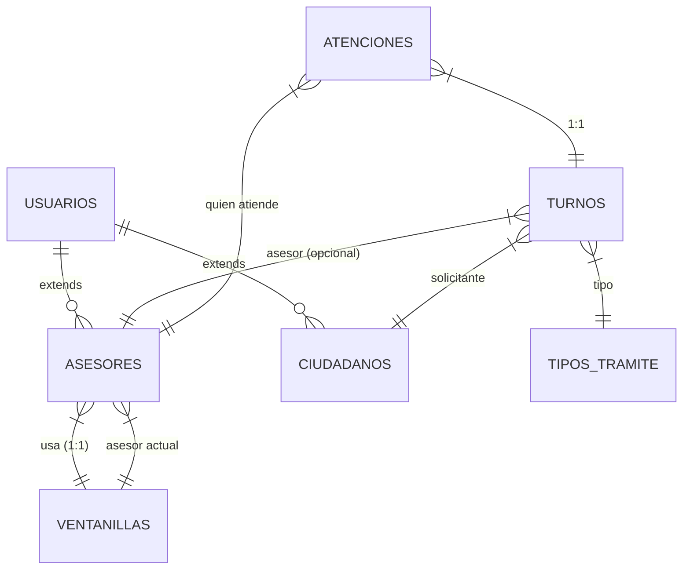

# Architecture — Agendaty

## Estilo
Backend y frontend separados. Backend Spring Boot (API REST), frontend React + Vite. No es monolítico.

## Capas del backend
```
controller  →  service  →  repository → entity
```

## Paquetes del backend
`com.proyecto.agendaty.controller`, `.service`, `.repository`, `.entity`, `.dto`, `.exceptions`

## Estructura de carpetas del frontend
```
frontend/
├── src/
│   ├── api/           # funciones por módulo (auth, turnos, atenciones, asesores, admin, reportes)
│   ├── components/    # UI reutilizable (Button, Input, Select, BadgeEstado, Loading, EmptyState, Alert, Navbar)
│   ├── pages/         # pantallas por rol (Login, Registro, Recepcionista, Asesor, Coordinador, Administrador, Ciudadano, Reportes)
│   ├── hooks/         # hooks personalizados
│   ├── routes/        # configuración de rutas y protección por rol
│   ├── context/       # AuthContext (sesión persistida)
│   ├── utils/         # utilidades (formato de fechas, mapeo de errores)
│   └── assets/        # imágenes, íconos
├── .env.example       # VITE_API_URL, VITE_USE_MOCK
├── vite.config.ts
├── package.json
└── README.md
```

## Estructura del repositorio
```
/backend   → Spring Boot (API REST), build propio, config, README
/frontend  → React + TypeScript + Vite, consume la API, .env.example, README
/docs      → documentación
```

## Flujo de una petición
1. Controller recibe HTTP, valida con `@Valid`, llama al service.
2. Service (transaccional) aplica reglas RN1-RN6 y RA6, accede al repository.
3. Repository (JPA) lee/escribe en BD (H2 en dev).
4. Controller devuelve DTO con código HTTP.

## Manejo de errores
`@RestControllerAdvice` con excepciones propias (`ResourceNotFoundException`, `BadRequestException`, `BusinessException`) → 404 / 400 / 409.

## CORS
`@CrossOrigin(origins = "http://localhost:5173")` en cada controller. Nunca `*` en producción.

## Concurrencia (RN1/RN4)
Validación en service dentro de `@Transactional`. Si es necesario, `@Version` en `Turno`.

## Diagrama de componentes (Mermaid)

```mermaid
graph TD
    subgraph Frontend "Frontend (React + Vite, puerto 5173)"
        F1[Pages por rol]
        F2[AuthContext + localStorage]
        F3[API client (axios/fetch)]
    end

    subgraph Backend "Backend (Spring Boot, puerto 8080)"
        B1[Controllers @CrossOrigin]
        B2[Services @Transactional]
        B3[Repositories JPA]
        B4[Entities JPA]
    end

    subgraph DB["(H2 en memoria, dev)"]
        D1[(Tablas: usuarios, turnos, atenciones, ...)]
    end

    F1 --> F3
    F2 --> F3
    F3 -->|HTTP + X-Usuario-Id| B1
    B1 --> B2
    B2 --> B3
    B3 --> B4
    B4 --> D1
```

## Diagrama entidad-relación (Mermaid)



## Configuración por perfiles
- `application.properties`: valores base (H2 en memoria, consola H2, puerto 8080).
- `ADMIN_EMAIL` y `ADMIN_PASSWORD` por variable de entorno para el seed del admin (RA3).
