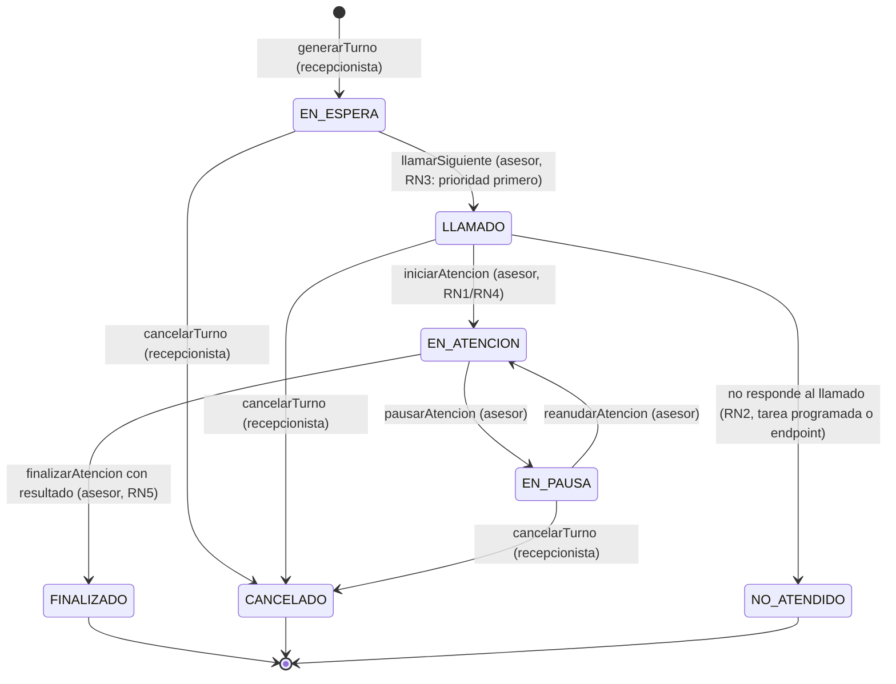

# Diseño detallado — Agendaty

> Contrato de diseño detallado. Se redacta ANTES de terminar el backend y se mantiene sincronizado con el código. Alimenta las Fases 3 (backend), 4 (tests) y 7/8 (frontend).

---

## 1. Modelo de dominio

### Entidades

| Entidad | Atributos principales | Relaciones |
|---------|----------------------|------------|
| `Usuario` (abstract, `@Inheritance(JOINED)`) | `id`, `nombre` | Padre de `Asesor` y `Ciudadano` |
| `Asesor extends Usuario` | `disponible`, `ventanillaActual` | 1:1 `Ventanilla`, N:1 con turnos atendidos |
| `Ciudadano extends Usuario` | `documento` (unique), `telefono` | N:1 con turnos solicitados |
| `Ventanilla` | `numero` (unique), `descripcion` | 1:1 `Asesor` (asesorActual) |
| `TipoTramite` | `id`, `nombre`, `codigo`, `esPrioritarioPorDefecto` | N:1 con turnos |
| `Turno` | `id`, `numeroTurno` (unique), `estado`, `prioridad`, `fechaCreacion`, `fechaLlamado`, `fechaFinEspera` | N:1 `Ciudadano`, N:1 `TipoTramite`, N:1 `Asesor` (opcional), 1:1 `Atencion` |
| `Atencion` | `id`, `turno`, `asesor`, `fechaInicio`, `fechaFin`, `observaciones`, `resultado`, `tiempoEspera`, `tiempoAtencion`, `totalPausas` | 1:1 `Turno`, N:1 `Asesor`, 1:N `Pausa` |
| `Pausa` | `id`, `atencion`, `fechaInicio`, `fechaFin`, `duracion` | N:1 `Atencion` |
| `Rol` | `id`, `nombre` | N:M con `Usuario` |
| `UsuarioRol` | `usuario`, `rol` | tabla unión |

### Enums (`com.proyecto.agendaty.model.enums`)

- `EstadoTurno`: `EN_ESPERA`, `LLAMADO`, `EN_ATENCION`, `EN_PAUSA`, `FINALIZADO`, `CANCELADO`, `NO_ATENDIDO`.
- `PrioridadTurno`: `NORMAL`, `PRIORITARIO`.
- `RolUsuario`: `ROLE_CIUDADANO`, `ROLE_ASESOR`, `ROLE_RECEPCIONISTA`, `ROLE_COORDINADOR`, `ROLE_ADMINISTRADOR`.

## 2. Máquina de estados del turno

**Quién ejecuta cada transición y reglas validadas:**

| Transición | Quién la ejecuta | Reglas validadas |
|------------|------------------|------------------|
| `generarTurno` | Recepcionista | CA1-CA4 (tipo trámite, número único, estado EN_ESPERA, prioridad) |
| `llamarSiguiente` | Asesor | RN3 (prioritarios primero, orden de llegada), turno en EN_ESPERA |
| `iniciarAtencion` | Asesor | RN1 (turno no atendido por otro asesor), RN4 (asesor sin turno activo) |
| `pausarAtencion` / `reanudarAtencion` | Asesor | turno en EN_ATENCION / EN_PAUSA respectivamente |
| `finalizarAtencion` | Asesor | RN5 (resultado obligatorio), RN6 (calcular tiempos) |
| `marcarNoAtendido` | Sistema (tarea programada) / Recepcionista | RN2 (turno LLAMADO sin respuesta) |
| `cancelarTurno` | Recepcionista | turno no FINALIZADO |

## 3. Numeración de turnos única

**Diseño:** prefijo por tipo de trámite + letra de prioridad + consecutivo diario.

Formato: `{CODIGO_TRAMITE}{P}-{NNNNN}` donde:
- `CODIGO_TRAMITE`: código corto del tipo de trámite (ej. `CED`, `PAG`, `MAT`).
- `P`: `P` para prioritario, `N` para normal.
- `NNNNN`: consecutivo de 5 dígitos, reiniciado cada día, por tipo de trámite y prioridad.

**Justificación:** garantiza unicidad sin depender de secuencias de BD globales, permite identificar al vuelo el tipo de trámite y la prioridad, y es legible para el ciudadano y el asesor. La unicidad se refuerza con restricción `unique` en `numeroTurno` y generación dentro de transacción con bloqueo sobre el contador diario (`ContadorTurno` entidad o secuencia por día).

## 4. Cálculo de tiempos (RN6)

- **Tiempo de espera:** `fechaLlamado - fechaCreacion` (o `fechaInicioAtencion - fechaCreacion` si no hubo llamado explícito). Se persiste en `Atencion.tiempoEspera` (minutos).
- **Tiempo de atención:** `fechaFin - fechaInicio - totalPausas`. Se persiste en `Atencion.tiempoAtencion` (minutos).
- `totalPausas` = suma de duraciones de pausas de la atención.
- Ambos campos se calculan al finalizar la atención y se exponen en reportes.

## 5. Contratos de API

Prefijo base: `/api/v1`. Formato de respuesta: `ResponseEntity<DTO>` o `ResponseEntity<Page<DTO>>` para listados paginados. Formato de error: `ErrorResponse(timeStamp, status, errorMessage, errorsDetails)`.

### 5.1 Autenticación
| Método | Ruta | Roles | Descripción |
|--------|------|-------|-------------|
| POST | `/api/v1/auth/login` | Público | Autentica usuario, devuelve JWT |
| POST | `/api/v1/auth/register` | Público / ADMIN | Registra usuario (ciudadano) |

### 5.2 Tipos de trámite
| Método | Ruta | Roles | Descripción |
|--------|------|-------|-------------|
| GET | `/api/v1/tipos-tramite` | Público / todos | Listar tipos de trámite |
| POST | `/api/v1/tipos-tramite` | ADMIN | Crear tipo de trámite |
| PUT | `/api/v1/tipos-tramite/{id}` | ADMIN | Actualizar |
| DELETE | `/api/v1/tipos-tramite/{id}` | ADMIN | Eliminar |

### 5.3 Turnos (solicitudes)
| Método | Ruta | Roles | Descripción |
|--------|------|-------|-------------|
| POST | `/api/v1/turnos` | RECEPCIONISTA | Generar turno (CA1-CA4) |
| GET | `/api/v1/turnos` | RECEPCIONISTA / ASESOR / COORDINADOR / ADMIN | Listar turnos (paginado, filtros) |
| GET | `/api/v1/turnos/{id}` | Todos (según propiedad) | Obtener turno |
| PUT | `/api/v1/turnos/{id}/llamar` | ASESOR | Llamar siguiente turno disponible (CA5, RN3) |
| PUT | `/api/v1/turnos/{id}/cancelar` | RECEPCIONISTA | Cancelar turno |
| PUT | `/api/v1/turnos/{id}/no-atendido` | RECEPCIONISTA / sistema | Marcar como no atendido (RN2) |

### 5.4 Atención
| Método | Ruta | Roles | Descripción |
|--------|------|-------|-------------|
| PUT | `/api/v1/atenciones/iniciar` | ASESOR | Iniciar atención (RN1, RN4) |
| PUT | `/api/v1/atenciones/{turnoId}/pausar` | ASESOR | Pausar atención |
| PUT | `/api/v1/atenciones/{turnoId}/reanudar` | ASESOR | Reanudar atención |
| PUT | `/api/v1/atenciones/{turnoId}/finalizar` | ASESOR | Finalizar con observaciones y resultado (RN5, RN6) |
| GET | `/api/v1/atenciones/asesor/{asesorId}` | ASESOR / COORDINADOR / ADMIN | Atenciones del asesor |

### 5.5 Asesores
| Método | Ruta | Roles | Descripción |
|--------|------|-------|-------------|
| GET | `/api/v1/asesores` | ADMIN / COORDINADOR | Listar asesores y disponibilidad |
| PUT | `/api/v1/asesores/{id}/disponible` | ADMIN | Cambiar disponibilidad |
| GET | `/api/v1/asesores/{id}/carga` | COORDINADOR / ADMIN | Carga de atención del asesor |

### 5.6 Ventanillas
| Método | Ruta | Roles | Descripción |
|--------|------|-------|-------------|
| GET | `/api/v1/ventanillas` | ADMIN / COORDINADOR / ASESOR | Listar ventanillas |
| POST | `/api/v1/ventanillas` | ADMIN | Crear ventanilla |
| PUT | `/api/v1/ventanillas/{id}` | ADMIN | Actualizar |
| DELETE | `/api/v1/ventanillas/{id}` | ADMIN | Eliminar |

### 5.7 Reportes
| Método | Ruta | Roles | Descripción |
|--------|------|-------|-------------|
| GET | `/api/v1/reportes/tiempo-espera-promedio` | COORDINADOR / ADMIN | Tiempo promedio de espera (filtros: fecha, asesor, tipo trámite) |
| GET | `/api/v1/reportes/turnos-atendidos` | COORDINADOR / ADMIN | Turnos atendidos (filtros) |
| GET | `/api/v1/reportes/tramites-frecuentes` | COORDINADOR / ADMIN | Trámites frecuentes (filtros) |

### 5.8 Usuarios / Roles
| Método | Ruta | Roles | Descripción |
|--------|------|-------|-------------|
| GET | `/api/v1/usuarios` | ADMIN | Listar usuarios |
| POST | `/api/v1/usuarios` | ADMIN | Crear usuario con rol |
| PUT | `/api/v1/usuarios/{id}/rol` | ADMIN | Asignar rol |

## 6. Diseño de los reportes

Todos los reportes admiten filtros opcionales: `fechaDesde`, `fechaHasta`, `asesorId`, `tipoTramiteId`. Resultado paginado o agregado.

- **Tiempo promedio de espera:** promedio de `Atencion.tiempoEspera` en el rango.
- **Turnos atendidos:** conteo de turnos `FINALIZADO` y `NO_ATENDIDO` por periodo.
- **Trámites frecuentes:** conteo agrupado por `TipoTramite`.

## 7. Diseño de UI/UX por rol

Alimenta las Fases 7 y 8 (ver `docs/frontend.md`).

| Rol | Vistas principales | Flujos clave |
|-----|-------------------|--------------|
| **Recepcionista** | Generar turno, lista de cola, cancelar turno | Selecciona tipo de trámite y prioridad → genera turno (CA1-CA4) → visualiza en cola → cancela si es necesario |
| **Asesor** | Su estado/ventanilla, llamar siguiente, iniciar/pausar/finalizar atención | Llama siguiente (CA5, RN3) → inicia atención (RN1/RN4) → pausa/reanuda → finaliza con observaciones y resultado (RN5/RN6) |
| **Coordinador** | Monitor de cola en tiempo casi real, carga por asesor | Polling de la cola → ve tiempos de espera → reasigna si es necesario |
| **Administrador** | Gestión de usuarios, roles, asesores, ventanillas, tipos de trámite | CRUD completo de administración |
| **Ciudadano** | Consulta estado de su turno y posición en cola | Ingresa su número de turno → ve estado y posición estimada |

**Principios de diseño:** estados de carga, error y vacío; validación alineada con el backend; confirmación en acciones destructivas; login, rutas protegidas y menús según rol; responsive y accesible.

## 8. Relación con la matriz de trazabilidad

Cada endpoint y regla de negocio arriba tiene su entrada en la matriz de trazabilidad de `docs/project-brief.md` (sección 9), con el test que lo valida (completado en Fase 4).
