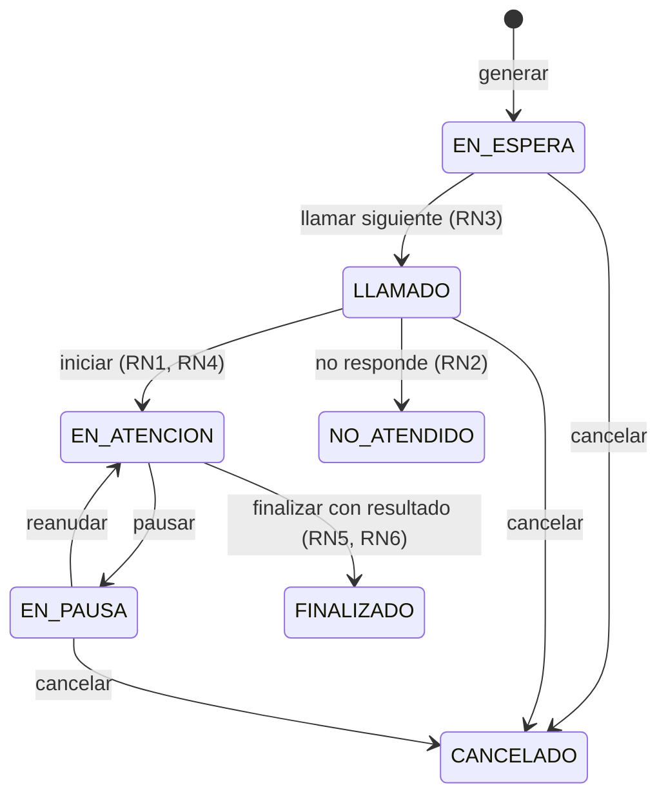

# Design — Agendaty

## Entidades
- `Usuario` (id, nombre, username, password, rol)
- `Asesor extends Usuario` (disponible, ventanillaActual)
- `Ciudadano extends Usuario` (documento, telefono)
- `Ventanilla` (numero, descripcion)
- `TipoTramite` (nombre, codigo, prioritarioPorDefecto)
- `Turno` (numeroTurno, estado, prioridad, fechaCreacion, fechaLlamado, ciudadano, tipoTramite, asesor)
- `Atencion` (turno, asesor, fechaInicio, fechaFin, observaciones, resultado, tiempoEspera, tiempoAtencion)

## Estados del turno (stateDiagram)

## Numeración de turnos
`{CODIGO_TRAMITE}{P|N}-{NNNNN}` (tipo + prioridad + consecutivo diario). Único en BD.

## Cálculo de tiempos (RN6)
- Espera: fechaLlamado - fechaCreacion
- Atención: fechaFin - fechaInicio (menos pausas)

## Endpoints
| Método | Ruta | Rol |
|--------|------|-----|
| POST | /turnos | Recepcionista, Admin |
| GET | /turnos | Todos autenticados |
| PUT | /turnos/llamar-siguiente | Asesor |
| PUT | /turnos/{id}/cancelar | Recepcionista, Admin |
| PUT | /turnos/{id}/no-atendido | Recepcionista, Admin |
| PUT | /atenciones/iniciar | Asesor |
| PUT | /atenciones/{id}/pausar | Asesor |
| PUT | /atenciones/{id}/reanudar | Asesor |
| PUT | /atenciones/{id}/finalizar | Asesor |
| GET | /asesores | Todos |
| GET | /ventanillas | Todos |
| GET | /reportes/* | Coordinador, Admin |

## Vistas por rol
- Recepcionista: generar turno, cola, cancelar
- Asesor: llamar siguiente, iniciar/pausar/finalizar atención
- Coordinador: monitor de cola, carga por asesor
- Administrador: usuarios, asesores, ventanillas, tipos de trámite
- Ciudadano: consultar estado de turno
