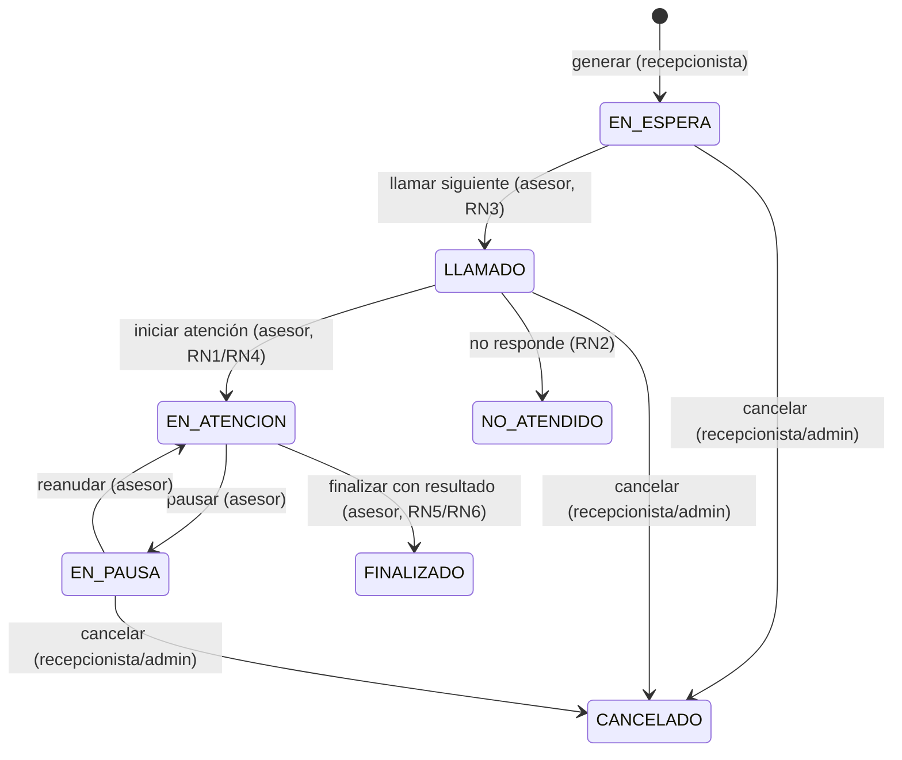

# Design — Agendaty

## Entidades y relaciones

| Entidad | Atributos principales | Relaciones |
|---------|----------------------|------------|
| `Usuario` | id, nombre, correo, password, rol (CIUDADANO/ASESOR/RECEPCIONISTA/COORDINADOR/ADMINISTRADOR) | Padre de Asesor y Ciudadano |
| `Asesor extends Usuario` | disponible, ventanillaActual | 1:1 Ventanilla, N:1 con turnos atendidos |
| `Ciudadano extends Usuario` | documento, telefono | N:1 con turnos solicitados |
| `Ventanilla` | numero, descripcion | 1:1 Asesor (asesorActual) |
| `TipoTramite` | nombre, codigo, prioritarioPorDefecto, activo | N:1 con turnos |
| `Turno` | numeroTurno, estado, prioridad, fechaCreacion, fechaLlamado, ciudadano, tipoTramite, asesor | N:1 Ciudadano, N:1 TipoTramite, N:1 Asesor, 1:1 Atencion |
| `Atencion` | turno, asesor, fechaInicio, fechaFin, observaciones, resultado, tiempoEspera, tiempoAtencion | 1:1 Turno, N:1 Asesor |

## Máquina de estados del turno

## Numeración de turnos (CA2)
Formato `{CODIGO_TRAMITE}{P|N}-{NNNNN}` donde:
- `CODIGO_TRAMITE`: código corto del tipo de trámite (ej. `CED`, `PAG`)
- `P|N`: `P` para prioritario, `N` para normal
- `NNNNN`: consecutivo de 5 dígitos, reiniciado cada día
- Único en BD (restricción `unique` en columna `numeroTurno`)

## Cálculo de tiempos (RN6)
- Tiempo de espera: `fechaLlamado - fechaCreacion` (minutos)
- Tiempo de atención: `fechaFin - fechaInicio` descontando pausas (minutos)
- Ambos se persisten en `Atencion` al finalizar

## CONTRATO DE API

### Autenticación

| Método | Ruta | Roles | Request | Response | Códigos |
|--------|------|-------|---------|----------|---------|
| POST | `/auth/registro` | Público | `{nombre, correo, password, documento, telefono}` | `{id, nombre, correo, rol}` | 201, 400 |
| POST | `/auth/login` | Público | `{correo, password}` | `{id, nombre, correo, rol}` | 200, 401 |

### Admin (solo ADMINISTRADOR, header X-Usuario-Id)

| Método | Ruta | Roles | Request | Response | Códigos |
|--------|------|-------|---------|----------|---------|
| POST | `/admin/usuarios` | ADMINISTRADOR | `{nombre, correo, password, rol, documento, telefono}` | `{id, nombre, correo, rol}` | 201, 400, 403 |
| GET | `/admin/usuarios` | ADMINISTRADOR | — | `[{id, nombre, correo, rol}]` | 200, 403 |

### Turnos

| Método | Ruta | Roles | Request | Response | Códigos |
|--------|------|-------|---------|----------|---------|
| POST | `/turnos` | RECEPCIONISTA, ADMINISTRADOR | `{ciudadanoId, tipoTramiteId, prioritario}` | `{id, numeroTurno, estado, prioridad, ...}` | 201, 400, 403 |
| GET | `/turnos` | Todos autenticados | — | `[{id, numeroTurno, estado, prioridad, ...}]` | 200, 403 |
| PUT | `/turnos/llamar-siguiente` | ASESOR | `{asesorId}` (query) | `{id, numeroTurno, estado, prioridad, ...}` | 200, 400, 403, 404 |
| PUT | `/turnos/{id}/cancelar` | RECEPCIONISTA, ADMINISTRADOR | `{usuarioId}` (query) | `{id, ..., estado: CANCELADO}` | 200, 400, 403, 404 |
| PUT | `/turnos/{id}/no-atendido` | RECEPCIONISTA, ADMINISTRADOR | — | `{id, ..., estado: NO_ATENDIDO}` | 200, 400, 403, 404 |

### Atención

| Método | Ruta | Roles | Request | Response | Códigos |
|--------|------|-------|---------|----------|---------|
| PUT | `/atenciones/iniciar` | ASESOR | `{turnoId, asesorId}` (query) | `{id, turnoId, fechaInicio, ...}` | 200, 400, 403, 404, 409 |
| PUT | `/atenciones/{turnoId}/pausar` | ASESOR | `{asesorId}` (query) | `{id, ..., estado: EN_PAUSA}` | 200, 400, 403, 404 |
| PUT | `/atenciones/{turnoId}/reanudar` | ASESOR | `{asesorId}` (query) | `{id, ..., estado: EN_ATENCION}` | 200, 400, 403, 404 |
| PUT | `/atenciones/{turnoId}/finalizar` | ASESOR | `{resultado, observaciones}` (body) | `{id, ..., estado: FINALIZADO, tiempoEspera, tiempoAtencion}` | 200, 400, 403, 404, 409 |
| GET | `/atenciones/turno/{turnoId}` | Todos autenticados | — | `{id, turnoId, ..., resultado, tiempoEspera, tiempoAtencion}` | 200, 404 |

### Asesores

| Método | Ruta | Roles | Request | Response | Códigos |
|--------|------|-------|---------|----------|---------|
| GET | `/asesores` | Todos autenticados | — | `[{id, nombre, disponible, numeroVentanilla}]` | 200, 403 |
| PUT | `/asesores/{id}/disponible` | ADMINISTRADOR | `{disponible}` (query) | `{id, nombre, disponible}` | 200, 400, 403, 404 |

### Ventanillas

| Método | Ruta | Roles | Request | Response | Códigos |
|--------|------|-------|---------|----------|---------|
| GET | `/ventanillas` | Todos autenticados | — | `[{id, numero, descripcion, asesorId}]` | 200, 403 |
| POST | `/ventanillas` | ADMINISTRADOR | `{numero, descripcion}` | `{id, numero, descripcion}` | 201, 400, 403 |
| PUT | `/ventanillas/{id}` | ADMINISTRADOR | `{numero, descripcion}` | `{id, numero, descripcion}` | 200, 400, 403, 404 |
| DELETE | `/ventanillas/{id}` | ADMINISTRADOR | — | — | 204, 403, 404 |

### Tipos de trámite

| Método | Ruta | Roles | Request | Response | Códigos |
|--------|------|-------|---------|----------|---------|
| GET | `/tipos-tramite` | Todos autenticados | — | `[{id, nombre, codigo, prioritarioPorDefecto, activo}]` | 200, 403 |
| POST | `/tipos-tramite` | ADMINISTRADOR | `{nombre, codigo, prioritarioPorDefecto}` | `{id, nombre, codigo, ...}` | 201, 400, 403 |
| PUT | `/tipos-tramite/{id}` | ADMINISTRADOR | `{nombre, codigo, prioritarioPorDefecto, activo}` | `{id, nombre, codigo, ...}` | 200, 400, 403, 404 |

### Reportes

| Método | Ruta | Roles | Request | Response | Códigos |
|--------|------|-------|---------|----------|---------|
| GET | `/reportes/tiempo-espera-promedio` | COORDINADOR, ADMINISTRADOR | `fechaDesde, fechaHasta` (query) | `{promedioMinutos, cantidad}` | 200, 403 |
| GET | `/reportes/turnos-atendidos` | COORDINADOR, ADMINISTRADOR | `fechaDesde, fechaHasta` (query) | `{atendidos, noAtendidos, total}` | 200, 403 |
| GET | `/reportes/tramites-frecuentes` | COORDINADOR, ADMINISTRADOR | `fechaDesde, fechaHasta` (query) | `[{tipoTramite, cantidad}]` | 200, 403 |

### Códigos HTTP
- 200: OK
- 201: Creado
- 204: Sin contenido (eliminación)
- 400: Solicitud incorrecta (validación o regla de negocio)
- 401: No autenticado (credenciales inválidas)
- 403: No autorizado (rol insuficiente)
- 404: Recurso no encontrado
- 409: Conflicto (turno ya tomado, asesor con turno activo, etc.)

## Mapa de pantallas por rol

| Rol | Pantallas | Flujo principal |
|-----|-----------|-----------------|
| Ciudadano | Login, Registro, Mi turno | Registrarse → Login → Consultar estado de turno |
| Recepcionista | Login, Generar turno, Cola, Cancelar | Login → Seleccionar trámite → Generar turno → Ver cola → Cancelar si es necesario |
| Asesor | Login, Panel asesor, Llamar siguiente, Iniciar/pausar/reanudar/finalizar | Login → Llamar siguiente → Iniciar atención → Pausar/reanudar → Finalizar con resultado |
| Coordinador | Login, Monitor de cola, Carga por asesor, Reportes | Login → Ver cola en vivo → Ver carga por asesor → Reportes |
| Administrador | Login, Gestión usuarios, Ventanillas, Tipos de trámite | Login → Registrar usuarios internos → Gestionar ventanillas y trámites |
